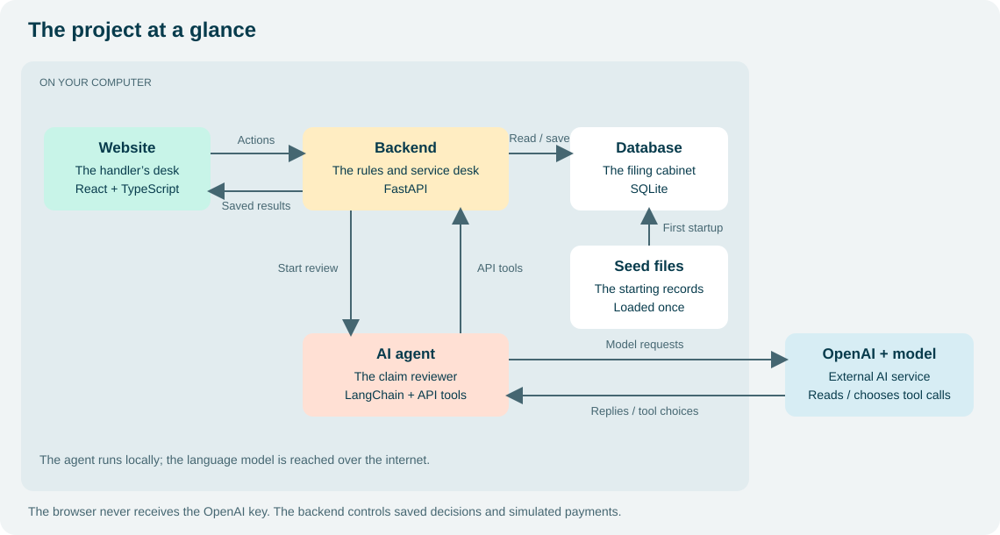
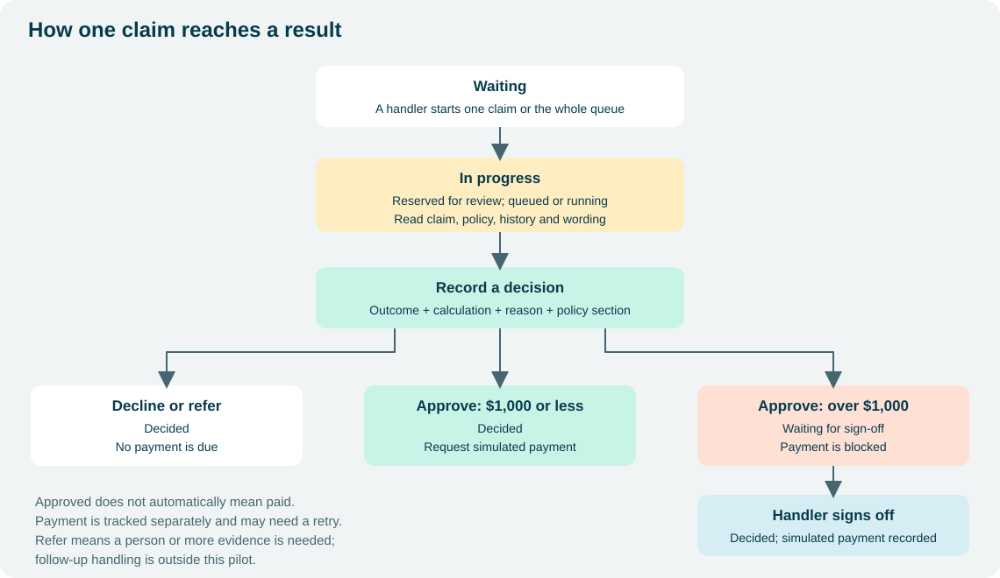
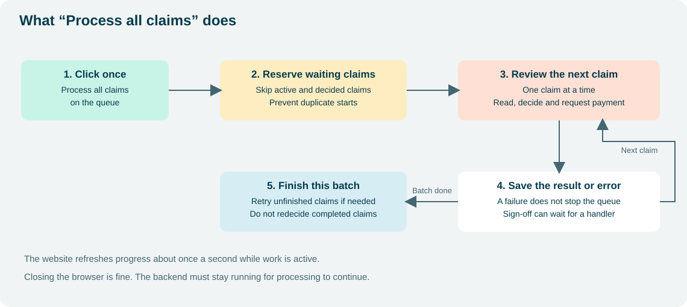

# UnderCover: a plain-language project guide

UnderCover is a practice travel insurance company. This project gives its claims team a website and an AI assistant that reviews claims, explains a decision and works out a payout.

A **claim** is a customer's request for money after something goes wrong on a trip. A **policy** is that customer's insurance agreement. A **claims handler** is the employee who reviews the request.

The current app is a local pilot with 25 fictional claims. It includes the **Process all claims** button, which reviews every waiting claim with one click. All money is in US dollars, and all payments are simulated.

## Contents

- [The problem we are solving](#the-problem-we-are-solving)
- [The main parts](#the-main-parts)
- [Following one claim](#following-one-claim)
- [Processing the whole queue](#processing-the-whole-queue)
- [The payment rule](#the-payment-rule)
- [Using the website](#using-the-website)
- [Where the information comes from](#where-the-information-comes-from)
- [Starting the project](#starting-the-project)
- [Terminal commands](#terminal-commands)
- [What happens after a failure](#what-happens-after-a-failure)
- [Finding your way around the code](#finding-your-way-around-the-code)
- [Testing and common problems](#testing-and-common-problems)
- [What the pilot does and does not prove](#what-the-pilot-does-and-does-not-prove)

## The problem we are solving

Normally, a handler reads a customer's account of an incident, checks the evidence and insurance terms, calculates what is covered, and records a decision. Repeating this for a queue of claims takes time.

UnderCover gives the first review to an AI agent. It is instructed to return one of three outcomes:

- **Approve:** the claim is covered, with an amount and calculation.
- **Decline:** the claim is not covered, with an explanation.
- **Refer:** someone needs to use judgment or obtain more evidence before the matter can be settled.

The handler can see the documents, the decision, the calculation, the relevant policy section and the agent's activity. A payout over $1,000 must still wait for a handler's sign-off.

## The main parts

Think of the app as a small insurance office:

- **The website is the work desk.** It shows the queue, claim details and action buttons. The code calls this the *dashboard* or *frontend*.
- **The backend is the service desk that enforces the rules.** It answers requests, starts reviews, saves results and checks whether payment is allowed.
- **The database is the filing cabinet.** It keeps claims, decisions, activity, sign-offs and payment records after the app closes.
- **The AI agent is the reviewer.** It gets instructions and evidence, asks a language model what to do, and uses a limited set of tools to act.
- **OpenAI supplies the external AI model.** The agent runs on your computer; model requests travel over the internet directly to OpenAI.



An **API** is the agreed way these parts ask each other to do things. For example, the website sends “start this claim,” while the agent sends “record this decision.” The backend receives both kinds of request and applies its rules.

The tools available to the model are ordinary functions supplied by our code:

- `read_context`: fetch this claim, its linked records and the full policy wording.
- `record_decision`: save the outcome, amount, calculation, explanation and policy section.
- `pay_claim`: ask the backend to record the exact approved payment.

The agent gets its instructions through the API too. It does not read the database or business files directly. It has no sign-off tool.

## Following one claim



Here is the journey in everyday language:

1. A handler opens a waiting claim and clicks **Process claim**, or starts the whole queue.
2. The backend reserves the claim so another click cannot start the same work again. It gives the attempt a unique tracking label, called a **thread ID**.
3. The agent receives its instructions and can read the customer's story, claimed items, document text, policy, plan, add-ons, history and full policy wording.
4. The model chooses tool calls. The instructions tell it to check coverage and calculate eligible amounts, compensation, deductibles and limits in the policy's specified order.
5. The agent records a decision, calculation, two- or three-sentence reason and relevant policy section. The saved decision appears on the website.
6. For an approval at or below $1,000, the agent is instructed to request simulated payment. For a larger approval, the claim waits for a handler.

The model may make several tool calls before finishing. The activity list shows actions and results, such as reading context or a blocked payment; it does not show the model's private internal reasoning.

The **Model for this review** card distinguishes the requested model (for example, `gpt-5-mini`) from the responding model names returned in API replies. All reported models for the latest review are shown. These names are saved with the activity and survive a reload. If metadata is missing, the app says so; it does not guess. Older reviews do not gain model names retroactively: reset and process again to capture them. Scripted test runs are labeled as test models.

### The four labels in the queue

- **Waiting:** available to start, including an unfinished claim that can be retried.
- **In progress:** reserved for work. In a batch, this includes claims queued behind the one currently being reviewed.
- **Waiting for sign-off:** the agent approved more than $1,000, but a handler has not yet released payment.
- **Decided:** an outcome is recorded and no sign-off is outstanding.

**Decided does not always mean paid.** A decline or referral has no payment. An approved claim can also be decided while its payment is still pending. Read the approved and paid amounts separately.

A referral finishes the agent's review for this pilot. There is no complete follow-up workflow for collecting more documents or resolving referrals in the current app.

## Processing the whole queue



The **Process all claims** button takes a snapshot of the waiting queue and reserves those claims together. The backend then reviews them **one at a time**, in claim ID order.

Existing decisions and active runs are skipped. A failed review records an error and does not stop later claims. Once the batch ends, you can retry any claims that returned to waiting. Claims waiting for sign-off keep that status until a handler acts.

The page asks for updated records about once a second while work is active. This is called **polling**. Closing the page does not cancel the batch because processing happens in the backend. The backend and your computer must remain running. A server restart interrupts processing; see [failure recovery](#what-happens-after-a-failure).

The button is disabled while work is active or when there are no waiting claims. This is a batch of individual reviews, not a group of agents debating a claim or learning from one another.

## The payment rule

The AI can request a payment, but the backend decides whether that request is allowed. Before saving a payment, it checks:

1. A saved approval exists.
2. The requested amount exactly matches the approved amount.
3. No payment has already been recorded.
4. If the amount is over $1,000, an eligible handler has signed off.

These checks and the payment save happen together, so two simultaneous requests cannot both record a payment. Payout records use whole cents: $12.34 is stored as 1,234 cents.

The boundary is exact: **$1,000.00 does not need sign-off; $1,000.01 does.** A blocked request leaves the claim unpaid even if the agent asks to pay it.

For example, suppose a claim is approved for **$1,250.00**. This is an illustration, not an evaluation result:

- The decision is **Approve** and the queue says **Waiting for sign-off**.
- The approved amount is $1,250.00; the paid amount is $0.00.
- A handler selects their name and clicks **Sign off and pay**.
- The backend saves the handler and time, releases the simulated payment and changes the queue status to **Decided**.

Selecting a handler records attribution. Since there is no sign-in, it does not verify who is using the website. “Paid” means a record was saved locally; no bank account receives money.

## Using the website

1. Open the **Claims queue** to see all 25 claims and the status counts. Use **Search claims** to find an ID, customer or incident, and **Queue status** to filter results. **Clear filters** restores the full view. Payment labels distinguish pending approvals, simulated payments and claims with no payment due.
2. Click **Process all claims**, or open a claim and click **Process claim**.
3. Open any claim to read its complete story, item amounts and supporting document text. Expand the policy, plan and customer sections for more detail.
4. Follow **Agent activity** and read **Decision**, including the calculation and policy reference.
5. For a larger approval, select a handler and click **Sign off and pay**.
6. If an eligible approval is saved but unpaid, use **Retry payment** once the run has finished. This does not repeat the coverage decision.
7. To start over, click **Reset claims** on the queue and confirm **Reset all claims**. This clears decisions, activity, sign-offs and simulated payments, keeping the original claim documents and linked records. All 25 claims return to Waiting. Reset is unavailable while work is active. Click **Process all claims** to review them again.
8. Open **Agent instructions** to see the instructions used by the agent. This view is read only.

The seeded documents are already text. This pilot does not include scanning new documents, reading uploaded PDFs or submitting new claims through the website.

## Where the information comes from

On first startup, the backend copies a specific set of source files into SQLite:

- `data/claims.json`: the 25 claims, stories, items and document texts.
- `data/policies.json`: each customer's trip, plan, travelers and purchased add-ons.
- `data/customers.json`: customer information and previous claim history.
- `data/plans.json`: Economy, Premium and First limits and add-on definitions.
- `data/handlers.json`: the people available for sign-off.
- `data/company.json`: the company name, currency and payout approval limit used by the pilot.
- `data/policy_wording.md`: the full insurance contract wording.

**Seed data** means starting information used to fill a new database. Once seeded, the app uses its saved copy. Editing a source JSON file does not update an existing database automatically.

The local file `undercover.db` contains two tables: `resources` for shared records, and `claims` for claim records with their decision, activity, sign-off and payment fields.

The claims manual is not used in this pilot. Manual-derived company settings are omitted from the information exposed to the agent. Evaluation answer keys in `data/evals/` stay outside the application, and held-out claims are not put in the queue. This keeps the agent from seeing the answers it might later be checked against.

## Starting the project

Use Python 3.12, uv and Node 26. **uv** installs and runs the Python dependencies; **npm**, supplied with Node, does the same for the website tools.

From a terminal in the repository root, run these commands on macOS or Windows PowerShell:

```sh
uv sync
npm install
```

Create or edit `.env` in the repository root and add your own key:

```dotenv
OPENAI_API_KEY=your-openai-key-here
```

The agent connects directly to OpenAI and defaults to `gpt-5-mini` with low reasoning effort. The current workspace selects that model explicitly in `.env`:

```dotenv
MODEL_NAME=gpt-5-mini
```

Model selection is defined in [`agent/main.py`](agent/main.py): `DEFAULT_MODEL` names the default and `model()` reads the `MODEL_NAME` override. Use an OpenAI model ID without an `openai/` prefix; OpenRouter names such as `openrouter/free` do not work with this endpoint. GPT-5 mini uses low reasoning effort whether selected by default or explicitly; other models use their default reasoning settings. Every request has an explicit 8,192-token response limit (`MAX_RESPONSE_TOKENS`), including reasoning where applicable. Restart the app after changing the key or model. Running real claims makes model requests; a full queue can make many requests, rather than one call for all claims.

Start the app:

```sh
npm run dev
```

This starts the backend and website together. Open:

- Website: http://localhost:5173
- Backend health check: http://localhost:8000/api/health
- Interactive API documentation: http://localhost:8000/docs

Keep the terminal open while processing claims. Press **Ctrl+C** to stop the app. `.env` and local database files are excluded from Git; do not put the API key in website code or documentation.

### Optional settings

- `UNDERCOVER_DB`: another SQLite file path instead of `undercover.db`. Set it in `.env` for the backend, then restart. A new filename, such as `undercover-demo.db`, starts a fresh copy of the seed queue while preserving the old database. Stop the app before changing databases.
- `BACKEND_URL`: the API address used by the agent. Set it in the terminal environment if changing the Vite proxy too; the proxy reads the startup environment. The normal setup needs no override.
- `UNDERCOVER_STUB=1`: synthetic workflow test mode. Leave it unset for actual AI review. Its scripted answers are not insurance judgments or accuracy evidence.

## Terminal commands

Run these commands from the repository root in a **second terminal**, while `npm run dev` stays running. They work on macOS and Windows PowerShell.

Reset the database's claim processing results, with an interactive confirmation:

```sh
uv run -m agent.cli reset
```

For a script or a reset you have already decided to perform, skip the prompt:

```sh
uv run -m agent.cli reset --yes
```

This is the same reset as the website button: it clears decisions, activity, sign-offs and simulated payments, preserving the claims and their documents. It does not delete the SQLite file or reload edited seed files. Reset is rejected while any claim is running or reserved in a batch.

Run one claim and wait for its result:

```sh
uv run -m agent.cli run CLM-1001 --wait
```

Run every waiting claim sequentially and wait for the queue to finish:

```sh
uv run -m agent.cli run --all --wait
```

For a complete rerun, reset first, then run `--all --wait`. Without `--wait`, either run command returns as soon as processing is accepted. Work continues in the backend and appears on the website. With `--wait`, the command prints saved decisions, calculations, reasons, policy sections, payment information and responding model names when available. Waiting for all claims includes any work that was already active and prints the full queue's results.

A review can finish successfully while still requiring handler sign-off; the terminal does not bypass that step. Failed reviews return exit code 1. Ctrl+C stops waiting and returns 130 without canceling started backend work. Invalid arguments return 2. A successful start, completed review or reset returns 0.

See the available options:

```sh
uv run -m agent.cli --help
uv run -m agent.cli run --help
uv run -m agent.cli reset --help
```

The CLI talks to the API at `BACKEND_URL`, or `http://localhost:8000` by default. Reset affects the database used by that running backend. The backend also chooses the model from its own configuration; restart it after changing `.env`.

If you only need terminal access, you can start the backend alone **instead of** `npm run dev`:

```sh
uv run -m uvicorn backend.main:app --port 8000
```

Keep that server running and use the commands above in another terminal. The website is optional for CLI use.

## What happens after a failure

If the model or a tool fails **before a decision is saved**, the error appears in activity and the claim returns to **Waiting**. You can retry it.

If the decision was **already saved**, it stays saved. Existing sign-offs and payments stay saved too. An eligible unpaid approval can retry payment without running the decision again.

On backend startup, unfinished runs from the previous process are marked interrupted. Claims with no saved decision return to waiting, including batch claims that had been reserved but not yet reviewed. You must start them again. The pilot does not resume an interrupted model conversation from its last step.

Refreshing the page or closing the browser is different from restarting the backend: it only changes what you are viewing, so background work can continue.

## Finding your way around the code

Start with these files when exploring the implementation:

- [dashboard/src/ClaimQueue.tsx](dashboard/src/ClaimQueue.tsx): queue search, status filters and payment labels.
- [dashboard/src/ClaimActivity.tsx](dashboard/src/ClaimActivity.tsx): latest-review model summary and activity timeline.
- [agent/cli.py](agent/cli.py): terminal commands that call the same backend operations as the website.
- [agent/activity.py](agent/activity.py): captures responding models from language-model response metadata.
- [dashboard/src/App.tsx](dashboard/src/App.tsx): page navigation, loading records and progress refresh.
- [dashboard/src/ProcessAllButton.tsx](dashboard/src/ProcessAllButton.tsx): the one-click queue action.
- [dashboard/src/ClaimDetail.tsx](dashboard/src/ClaimDetail.tsx): documents, decision, activity and sign-off controls.
- [backend/main.py](backend/main.py): API operations and background execution, including the sequential batch loop.
- [backend/workflow.py](backend/workflow.py): claim reservations, decisions, payment checks, sign-off and recovery.
- [backend/store.py](backend/store.py): SQLite storage, seeding and backend-owned instructions.
- [agent/main.py](agent/main.py): `run(claim_id, thread_id)`, model configuration and the three API tools.
- [e2e/health.spec.ts](e2e/health.spec.ts): browser tests of complete workflows, including process-all.

**React** builds the screens. **TypeScript** checks the website's data types. **Vite** serves the website during development. **FastAPI** exposes the Python API. **SQLite** stores data in a local file. **LangChain** connects the language model to our tools.

This standalone repository contains the claims website, backend, agent, required fictional seed data and tests. The project diagrams are in `docs/diagrams/`.

### Useful API addresses

`GET` reads information; `POST` asks the app to perform an action. These paths are relative to `http://localhost:8000`:

- `GET /api/claims` and `GET /api/claims/{claim_id}`: queue and full claim records.
- `POST /api/claims/reset`: clear processing results and return claims to waiting; reject the request if any claim is active.
- `POST /api/claims/run`: reserve every waiting claim; return the number queued.
- `POST /api/claims/{claim_id}/run`: start one claim; return its thread ID.
- `GET /api/claims/{claim_id}/progress`: read activity; `POST` to the same path records an event for the current run.
- `POST /api/claims/{claim_id}/decision`: record an outcome, amount, calculation, reason, policy section and thread ID.
- `POST /api/claims/{claim_id}/pay`: request a payment with its amount.
- `POST /api/claims/{claim_id}/sign-off`: sign off using a handler ID and release payment.
- `GET /api/instructions`, `/api/policy-wording` and `/api/handlers`: instructions, full wording and handler choices.

Replace `{claim_id}` with a real ID such as `CLM-1001`. The interactive documentation shows the required request bodies. Starting work returns **202 Accepted**: the review was scheduled, not necessarily completed. **404** means a record was not found, **422** means input was invalid, and **409** means the action conflicts with the current state, such as trying to pay twice.

## Testing and common problems

Run the complete checks from the repository root:

```sh
npm run check
```

This checks Python and TypeScript formatting, code rules, types, unit/component tests, coverage gates and browser workflows. Python tests use pytest; website component tests use Vitest; Playwright operates a browser to exercise the full app.

Tests use a **stub model**: a substitute that returns predetermined tool calls. That lets us test the workflow without paying for AI calls or depending on unpredictable replies. Browser tests use ports **8123** and **5175**, a disposable database and a separate test entry point. They do not process your development queue.

For a narrower check, use `npm run check:python`, `npm run check:ts` or `npm run e2e`. The project requires at least 80% coverage for the configured Python and website statement coverage gates. Run the checks locally to see the current results.

Common problems:

- **The website opens but claims do not load:** check that `npm run dev` is still running and the backend health address responds.
- **Model requests fail:** confirm that `OPENAI_API_KEY` is set and `MODEL_NAME` is an OpenAI model ID, then restart the backend. The agent activity records the error for the failed review. Each response is limited to 8,192 tokens.
- **A review fails:** inspect the claim's activity and backend terminal. Check the key, model name, provider access and connectivity, then retry unfinished work.
- **Process all claims is disabled:** work is already active, or no waiting claims remain. Sign-off and decided claims are not started again.
- **An approval is unpaid:** check whether sign-off is required. Otherwise, wait for the run to finish and use Retry payment.
- **A source-data edit has no effect:** existing databases are not reseeded. Use a new database filename if you want a fresh demo queue.
- **A server reports its port is in use:** stop the other instance using that port. Tests deliberately refuse to reuse a development server.

## What the pilot does and does not prove

The current app demonstrates a complete claim-review workflow: reading evidence, recording decisions, displaying progress and enforcing a payment limit. It uses fictional records and does not include sign-in, bank payments, customer messaging, document uploads, a referral-resolution screen or production deployment.

The payment safeguards are enforced in application code. The model's coverage judgment and calculation can still be wrong. Passing workflow tests does not establish insurance-decision accuracy. Evaluation files have remained unopened during this build, and no accuracy score or live-model smoke-test result is claimed.

For the quick-start instructions, read the [short run guide](backend/README.md).
